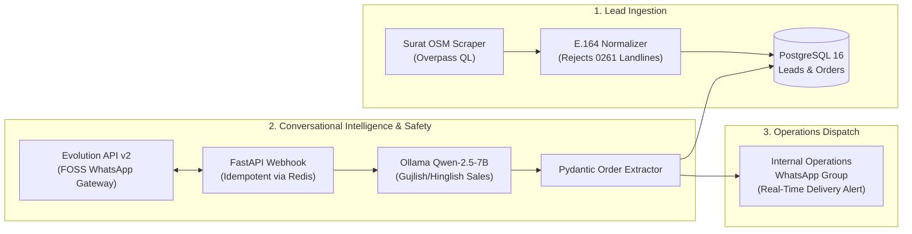

# 🧄 AllioBot: Autonomous B2B WhatsApp Sales Agent for Surat HoReCa

[](https://opensource.org/licenses/MIT)
[](https://www.python.org/)
[](https://fastapi.tiangolo.com/)
[](https://docs.docker.com/compose/)
[](#zero-cost-stack)

> Production-grade, fully automated AI sales agent optimized for selling **ready-to-use dry peeled garlic (unit price ₹120/kg)** via WhatsApp to restaurants, dhabas, caterers, and commercial kitchens across Surat, Gujarat.

---

## 📌 Architecture Overview



---

## 🛡️ Critical Safety Protocol: Single-Number Infrastructure

> ⚠️ **IMPORTANT ARCHITECTURAL ADVISORY:**  
> The user has designated **ONLY ONE primary WhatsApp number** for this deployment.  
> Unsolicited mass-messaging to hundreds of strangers from a single personal or business number will trigger automated spam reporting and lead to a permanent WhatsApp account ban.

### How AllioBot Protects Your Single Number:
1. **The Inbound "Pull" Funnel (Zero Ban Risk):**  
   WhatsApp **never bans** a number for responding to incoming inquiries. Drive inbound chefs to your number using direct Click-to-WhatsApp links:
   `https://wa.me/91XXXXXXXXXX?text=Hi%20Kishan,%20send%20500g%20peeled%20garlic%20sample%20to%20my%20kitchen`
2. **Strict Daily Outbound Cap:**  
   Outbound cold introductions are strictly rate-limited to **25 new contacts per day** via `MAX_OUTBOUND_PER_DAY=25`.
3. **Poisson Stochastic Jitter:**  
   Delays between outbound messages follow an exponential Poisson distribution between **180 and 420 seconds (3 to 7 minutes)**, simulating human pacing.
4. **Circadian Time-Gating:**  
   Cold outreach is permitted only during prep hours:
   - **09:30 AM – 11:30 AM IST** (Before lunch rush)
   - **03:30 PM – 05:30 PM IST** (Before dinner prep)
   - *Strictly locked during kitchen service (12:00–15:00) and night hours.*
5. **Human Presence Simulation:**  
   Emits genuine `read` receipts and a `composing` (typing...) status for 2.5–6.0 seconds prior to every dispatch.

---

## 🚨 Operations Alert: Internal WhatsApp Group

When a customer confirms an order or requests a trial sample, AllioBot instantly extracts the structured order and posts a formatted notification to your **Internal Operations WhatsApp Group**:

```text
🚨 *NEW COMMERCIAL ORDER CONFIRMED!*
─────────────────────────
📦 *Order Code:* ORD-A81E9F
🏢 *Kitchen/Restaurant:* Hotel Tulsi (Piplod)
📞 *Customer Phone:* +9198251XXXXX
⚖️ *Quantity:* 15.0 kg
💰 *Price/kg:* ₹110.00 (Total: ₹1,650.00)
📍 *Delivery Locality:* Piplod
🏠 *Address:* Opp. Iscon Mall, Dumas Road, Piplod, Surat
⏰ *Delivery Slot:* 05:00 - 08:00 AM (Morning Prep)
💳 *Payment Mode:* COD_UPI
─────────────────────────
👉 *Dispatch Action:* Pack in Food-Grade Liner Crate & Assign to Reefer Route (Piplod).
```

---

## 🚀 Quickstart Guide (100% Zero-Cost FOSS)

### Prerequisites
- Docker & Docker Compose installed
- A dedicated workstation or VM (e.g. Oracle Cloud Always Free 4 OCPU ARM, 24GB RAM)
- 1 Phone running WhatsApp (your primary number)

### 1. Clone the Repository
```bash
git clone https://github.com/<your-username>/alliobot-whatsapp-agent.git
cd alliobot-whatsapp-agent
```

### 2. Configure Environment Variables
```bash
cp .env.example .env
```
Edit `.env` and fill in:
- `USER_PHONE_NUMBER`: Your WhatsApp number (e.g., `+9198250XXXXX`)
- `OPERATIONS_GROUP_JID`: Your internal WhatsApp group JID (e.g., `120363028475918234@g.us`)

### 3. Launch Docker Compose Stack
```bash
docker compose up -d
```
This boots the core microservices in under 5 seconds (with **zero heavy model downloads**):
1. `alliobot_postgres`: PostgreSQL 16 with pre-initialized schemas
2. `alliobot_redis`: Redis 7.2 queue and cache
3. `alliobot_evolution_api`: WhatsApp Web WebSocket gateway
4. `alliobot_app`: FastAPI webhook, sales engine, and Cloud AI Pool connector

*(Note: Local Ollama is 100% optional! By default, AllioBot routes through the high-speed Free Cloud AI Pool.)*

### 4. Connect Free Cloud AI Pool (No Downloads Required!)
AllioBot includes an automated multi-provider failover pool:
- **GitHub Models:** Uses your existing GitHub personal token (`gh auth token`) to access Llama 3.1 70B for free!
- **Groq Cloud (Optional):** Free ultra-fast Llama 3.3 70B (get key at [console.groq.com](https://console.groq.com/keys)).
- **OpenRouter Free (Optional):** Free models like Qwen 2.5 72B (get key at [openrouter.ai](https://openrouter.ai/keys)).

Simply add your key(s) to `.env`. If one provider ever experiences downtime, AllioBot automatically fails over to the next provider in the pool.

### 5. Pair Your WhatsApp Number
1. Open your browser and navigate to Evolution API manager: `http://localhost:8080/manager`
2. Create instance `alliobot_primary_instance`
3. Scan the generated QR Code using WhatsApp on your primary phone (**Linked Devices -> Link a Device**).
4. Configure Webhook URL in Evolution API to: `http://app:8000/webhook/whatsapp` (events: `MESSAGES_UPSERT`).

### 6. Finding Your Internal WhatsApp Group JID
To find the JID of your operations team group, execute:
```bash
curl -X GET http://localhost:8080/group/fetchAllGroups/alliobot_primary_instance \
  -H "apikey: alliobot_secret_foss_api_key_2026"
```
Copy the JID ending in `@g.us` for your dispatch group and set it as `OPERATIONS_GROUP_JID` in `.env`.

### 7. Trigger Surat Lead Scraping
```bash
curl -X POST http://localhost:8000/leads/scrape
```
Scrapes OpenStreetMap Overpass API for restaurants in Surat, normalizes phone numbers, and seeds PostgreSQL.

### 8. Trigger Safe Outbound Batch
```bash
curl -X POST http://localhost:8000/leads/dispatch-outbound
```
Dispatches 25 personalized invitations spaced 3–7 minutes apart to protect your number.

---

## 🗄️ Database Schema Summary

The database is structured in PostgreSQL with ACID guarantees:
- `leads`: Business name, E.164 phone, locality, cuisine, opt-out timestamp.
- `conversations`: Active thread state and lifecycle tracking.
- `messages`: Full conversation transcript, sender types, token logs.
- `orders`: Extracted orders, quantities, unit prices, delivery addresses, and group alert flags.

---

## 📦 Pushing to Your GitHub Repository

```bash
git init
git add .
git commit -m "feat: initial release of AllioBot WhatsApp B2B sales agent"
git branch -M main
git remote add origin https://github.com/<your-username>/alliobot-whatsapp-agent.git
git push -u origin main
```

---

## 📄 License
Released under the [MIT License](LICENSE). 100% Free and Open-Source Software.
